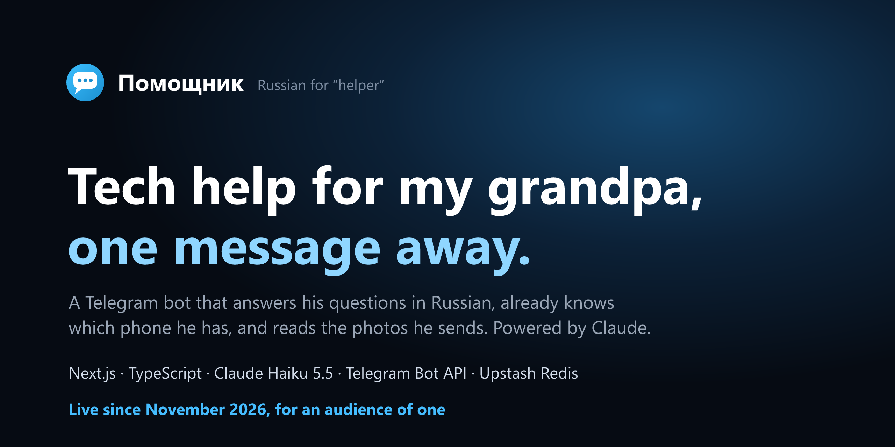
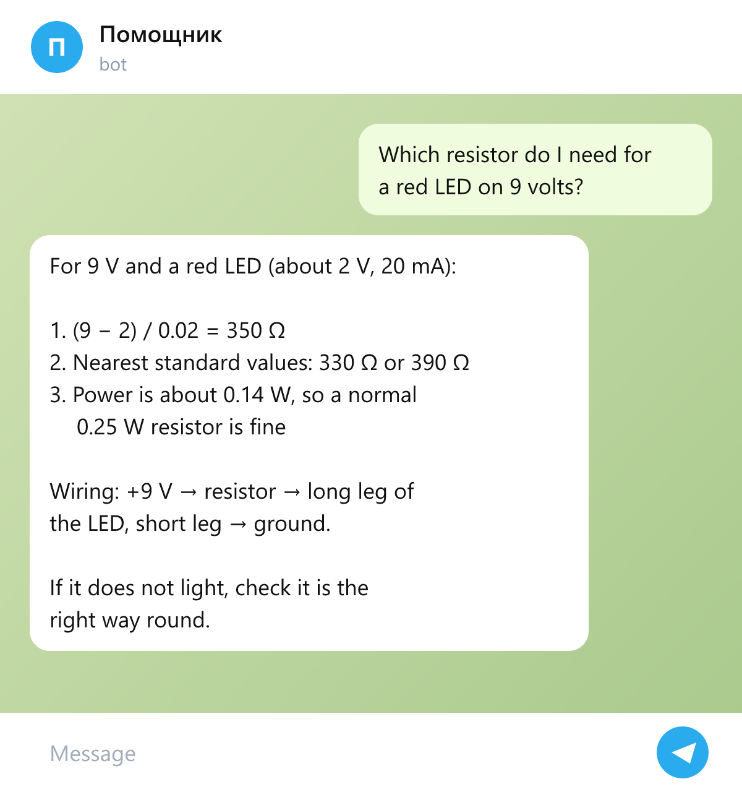
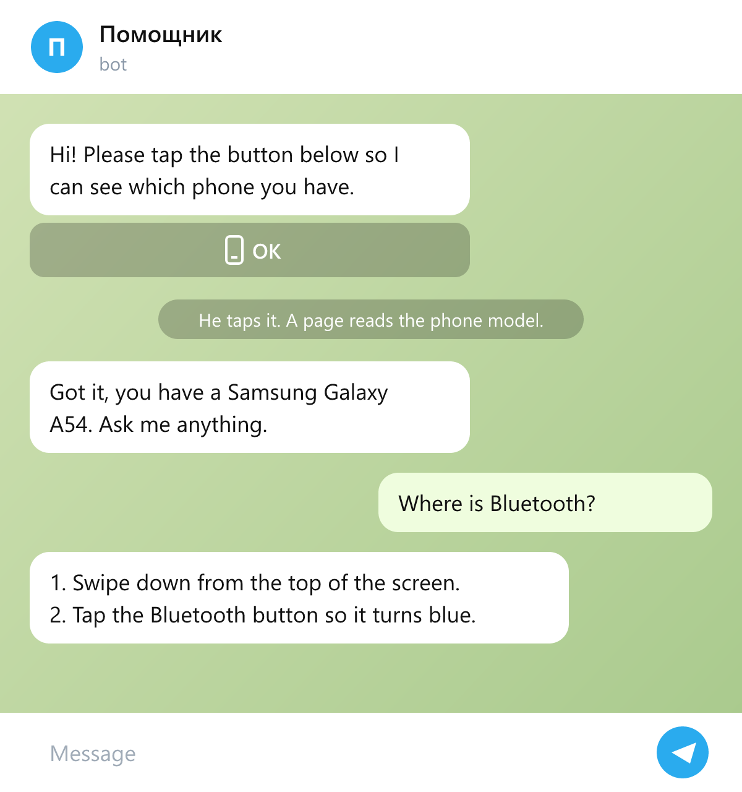
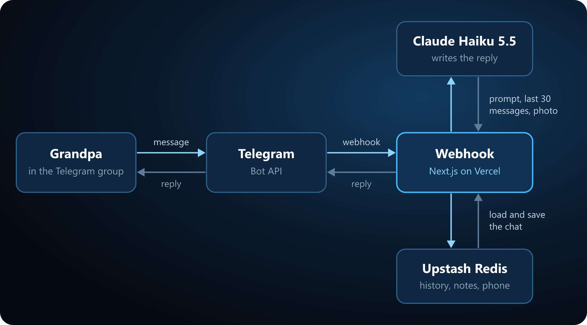
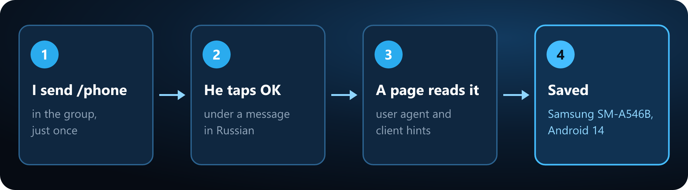

# Помощник

**Tech help for my grandpa, in Russian, from another country.**

---

My grandpa lives in another country, so I can't sit next to him and fix his phone. Помощник (Russian for "helper") is a bot that lives in a Telegram group with him. He writes to it the way he would write to a person, in Russian, and it answers every message using Claude. It already knows which phone he has, it reads the photos he sends, and it never asks for a password.

## What it does

- **Answers every message.** There are no commands for him to learn. He writes, and the reply comes back in Russian.
- **Knows his phone.** One tap on a button tells the bot his exact model, so it never has to ask "what phone do you have?" and its steps use the real menu names on his screen.
- **Reads photos.** A screenshot of a confusing screen, a plant from the garden, a part for a circuit. It works out what it is and explains.
- **Talks electronics.** He builds electronics as a hobby, so circuit questions get the full parts list and wiring with pin numbers in one go.
- **Looks out for scams.** It never asks for passwords or codes. When a message pressures him, offers a prize or claims a problem with his bank, it tells him to stop and check with family first.
- **Remembers the conversation.** The last 30 messages are kept for 14 days, so he can go and buy solder and pick up where he left off.

## A look inside

<table>
  <tr>
    <td width="50%"> <b>Electronics</b>: a real answer, translated from Russian and shortened</td>
    <td width="50%"> <b>Phone check</b>: how the one-tap setup works (illustration)</td>
  </tr>
</table>

## How it works

1. **He sends a message** in the Telegram group, as text or a photo.
2. **Telegram passes it to a webhook** on Vercel. The route answers Telegram straight away and does the slow work afterwards, so Telegram never sends the same message twice.
3. **The bot loads what it knows** from Upstash Redis, which is the recent conversation, his phone and the notes I wrote about him.
4. **Claude writes the reply** with any photo attached, and the bot posts it back to the group.

## One-tap phone detection

"What phone do you have?" is a question he can't easily answer, so the bot never asks it. Instead I send `/phone` in the group once. The bot posts a short line in Russian with a 📱 OK button, and when he taps it a small page opens, shows a big ✅ and reads what the browser knows about the phone.

- **Telegram for Android** adds the maker, model and Android version to the user agent of its own browser.
- **Chrome's client hints** fill in the model when the user agent hides it.
- **iPhones** keep the model private, so the bot gets the iOS version and screen size and works out the rest from screenshots.
- **The link is signed** with an HMAC of the chat id, so only a link the bot sent can save a phone to a chat.

## Keeping it cheap

| Piece | Cost |
|---|---|
| Claude Haiku 5.5 at high effort | about 0.1 to 0.15 cents per message |
| Claude API credit | $5 prepaid with auto reload off, so it can never cost more than that |
| Vercel Hobby | free |
| Upstash Redis | free plan, with a daily job so the database never sits idle |

## What testing taught me

- **Telegram shows markdown as raw asterisks.** Haiku sometimes wrote bold text anyway, so the bot now strips markdown before sending.
- **Small jobs need small prompts.** One setup message came back with the model's own reasoning in Spanish in front of it. Setup messages now get a tiny prompt of their own.
- **It assumed every message came from a beginner.** A question about an amplifier chip got a scam warning. My own messages are now labelled as mine, and warnings only appear when there is a real warning sign.
- **Step by step suits phones, not circuits.** Phone help still comes one or two steps at a time. Electronics questions get the whole answer at once.
- **Hardware facts were solid, software menus were not.** It invented exact menu paths in programming software, so now it only gives a path when it is sure and otherwise describes what to look for.
- **No internet means no made up links.** It only links stable manufacturer pages and adds the exact words to search for.

## Under the hood

- **Next.js 16 (App Router) with TypeScript** on Vercel. The webhook replies to Telegram at once and makes the Claude call in `after()`.
- **Claude Haiku 5.5** through the Anthropic SDK at high effort, with photos sent as image input.
- **Upstash Redis** holds the chat history, the settings for each chat, and a check that stops a repeated Telegram delivery from getting two replies.
- **Telegram Bot API** over a webhook. The secret header comes from the bot token, and a setup route points Telegram at the deployment.
- **Owner only commands** (`/enable`, `/about`, `/phone`, `/status`, `/forget`), so nobody else can change the bot or spend the credit.
- **Parked for later.** Drawn circuit diagrams (SVG rendered to PNG) and an owner only `/opus` command for the hardest questions are built and waiting on a branch.

## About

Built and run by **Andrey Yermolenko** for one very important user. The bot is private and so is its source, so this repo is a case study.
